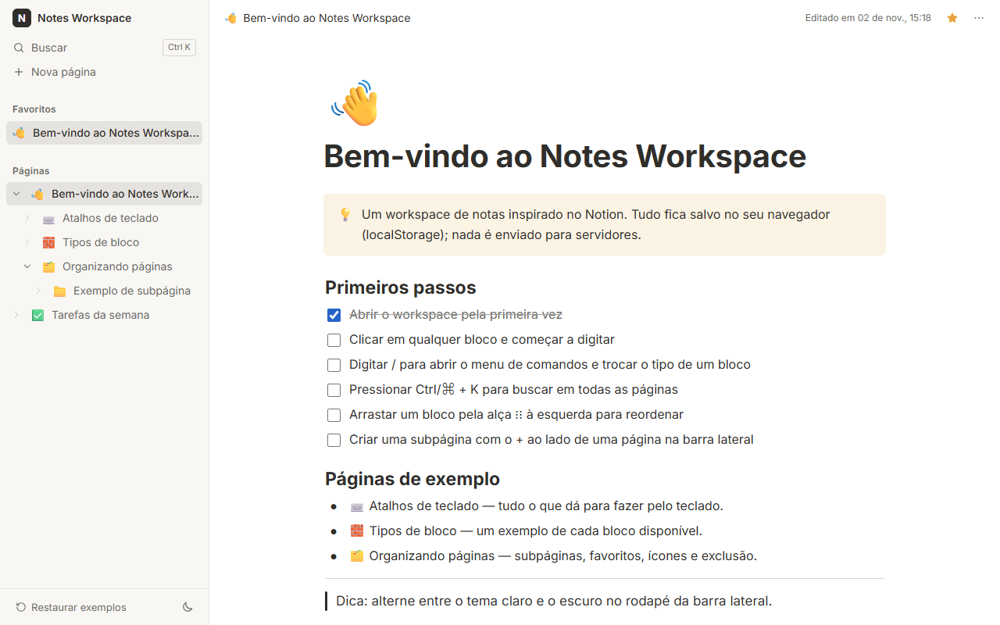

# Notes Workspace

[🇧🇷 Português](./README.md) · 🇺🇸 English

A Notion-inspired notes workspace built with React 19, TypeScript and Zustand. Pages form a nested
tree in the sidebar and every page is a block editor (text, headings, to-dos, lists, quote, code,
divider and callout) with a `/` command menu, Markdown shortcuts, drag and drop reordering (keyboard
included) and quick search with `Ctrl/⌘ + K`. Everything is stored in the browser's `localStorage`
with a versioned, migrated schema. The UI is available in Portuguese (default) and English.

**Demo:** https://portfolio.brunoisaac.dev/react-notes-workspace/



## Highlights

- Page tree: create, rename inline, nest/un-nest, collapse, delete with confirmation, favorites and
  an emoji icon per page.
- Block editor built on auto-growing textareas: Enter splits blocks (lists continue), Backspace
  merges or deletes and focuses the previous block, arrow keys move between blocks.
- `/` command menu (filterable, keyboard navigable, searchable in both languages) and Markdown
  shortcuts (`#`, `-`, `1.`, `[]`, `>`, ` ``` `, `---`).
- dnd-kit reordering with pointer, touch and keyboard sensors plus localized screen reader
  announcements.
- Quick search over titles and content (accent-insensitive, highlighted snippets), breadcrumbs,
  light/dark theme, responsive drawer sidebar, welcome pages created in the active language.

## Stack

React 19.2 · TypeScript 6.0 (strict) · Vite 8.1 · Zustand 5 (`persist`) · Immer 11 · dnd-kit
(core 6.3, sortable 10) · i18next 26 + react-i18next 17 · Vitest 4 + Testing Library · ESLint 10 +
Prettier 3 · CSS Modules with CSS custom properties.

## Architecture in short

- Normalized state (`pages` record + `rootIds`/`childIds`); tree and block operations are pure
  functions (Immer) with their own unit tests; the Zustand store only wires ids and timestamps.
- Persisted data has a schema version with step-by-step migrations and a sanitizer that repairs
  dangling references and orphan pages on load.
- WAI-ARIA patterns for menus, listbox/combobox and modal dialogs (focus trap and focus return).

## Internationalization

- i18next with bundled, typed TypeScript resources per namespace in `src/i18n/locales/<lang>/`;
  pt-BR is the source shape and other languages are type-checked against it.
- Language priority: saved choice (`localStorage`) > browser language (`pt*` → pt-BR, anything else
  → en) > pt-BR. The switcher lives in the top bar and keeps `<html lang>` in sync.
- Dates use `Intl` with the active locale. Existing pages are user content and are not translated
  when the language changes.
- To add a language: create `src/i18n/locales/<lang>/` with the same namespaces, register it in
  `src/i18n/resources.ts`, adjust `normalizeLanguage` and add its name to `common.language.names`.

## Running locally

```bash
npm install
npm run dev      # http://localhost:5173
npm test         # Vitest
npm run lint     # ESLint
npm run build    # type check + production build
npm run build:cf # same build with the /react-notes-workspace/ base (used for deploy)
```

## Deploy

Published on Cloudflare (Workers static assets) at https://portfolio.brunoisaac.dev/react-notes-workspace/ by the pipeline of
the [portfolio](https://github.com/BrunoICosta/portfolio) repository, which runs `npm run build:cf`
and ships the `dist/` folder. This repository only keeps CI (lint, format, tests and build).

## Author

Bruno Vinicius Isaac Costa · https://github.com/BrunoICosta · [MIT License](./LICENSE)
