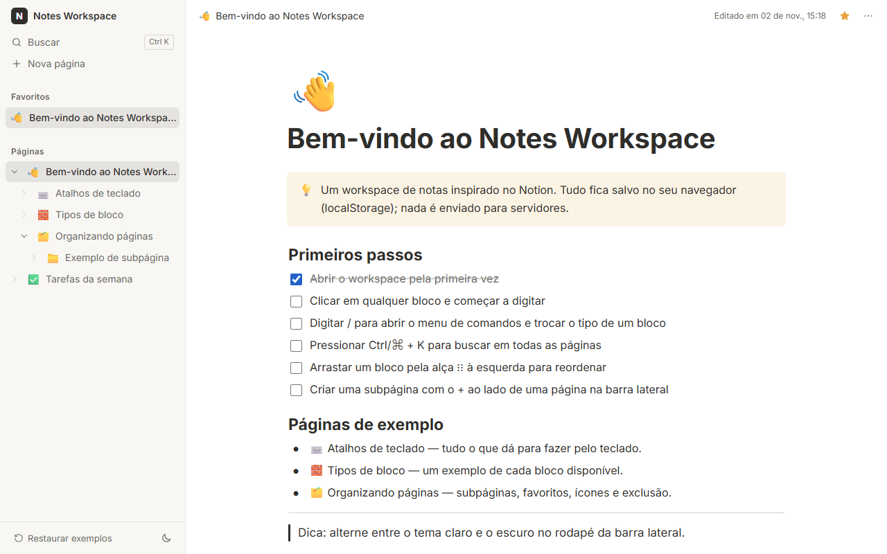
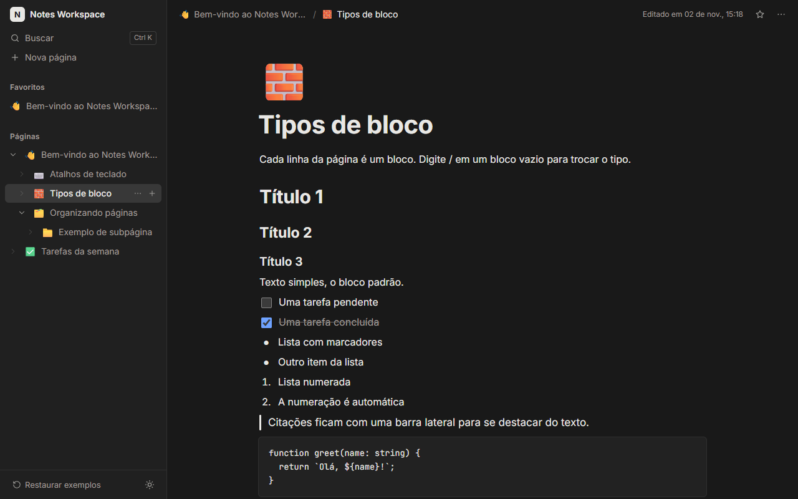

# Notes Workspace

Workspace de notas inspirado no Notion, feito com React 19, TypeScript e Zustand. As páginas formam
uma árvore aninhada na barra lateral e cada página é um editor de blocos (texto, títulos, tarefas,
listas, citação, código, divisor e destaque), com menu de comandos por `/`, atalhos de Markdown,
reordenação por arrastar e soltar (inclusive pelo teclado) e busca rápida com `Ctrl/⌘ + K`. Tudo
fica salvo no `localStorage` do navegador, com versionamento e migração do formato salvo.

**Demo:** https://brunoicosta.github.io/react-notes-workspace/



<details>
<summary>Tema escuro</summary>



</details>

## Funcionalidades

- **Árvore de páginas:** criar, renomear (inline, duplo clique ou `F2`), aninhar/desaninhar,
  recolher ramos e excluir com confirmação (avisando quantas subpáginas serão removidas).
- **Favoritos e ícones:** seção de favoritos na barra lateral e um emoji por página, escolhido em
  um seletor navegável pelo teclado.
- **Editor de blocos:** parágrafo, título 1/2/3, tarefa com checkbox, lista com marcadores, lista
  numerada (numeração automática), citação, código (fonte monoespaçada, `Tab` indenta), divisor e
  destaque.
- **Menu de comandos `/`:** filtra por nome ou palavra-chave (sem acento, pt-BR e inglês) e é
  navegável por setas, `Enter`/`Tab` e `Esc`, sem tirar o foco do bloco.
- **Teclado em primeiro lugar:** `Enter` cria um bloco (listas continuam; item vazio sai da
  lista), `Backspace` no início converte, junta ou exclui e foca o bloco anterior, `↑`/`↓` navegam
  entre blocos e o título.
- **Atalhos de Markdown:** `#`, `##`, `###`, `-`, `1.`, `[]`, `>`, ` ``` ` e `---`.
- **Arrastar e soltar:** reordenação de blocos com dnd-kit pela alça, com mouse, toque ou teclado
  (`Espaço` + setas) e anúncios para leitores de tela em português.
- **Busca rápida (`Ctrl/⌘ + K`):** títulos e conteúdo, sem diferenciar acentos, com trecho
  destacado e o caminho da página.
- **Trilha de navegação** (breadcrumbs) que se resume em telas pequenas ou caminhos longos.
- **Tema claro/escuro** salvo e aplicado antes da primeira pintura (sem flash).
- **Persistência versionada:** migrações passo a passo e saneamento dos dados ao carregar
  (referências quebradas e páginas órfãs são reparadas em vez de quebrar a aplicação).
- **Páginas de boas-vindas** que explicam os recursos, com opção de restaurá-las.
- **Responsivo:** em telas pequenas a barra lateral vira uma gaveta (drawer) com foco gerenciado.

## Stack

| Tecnologia                                         | Versão          |
| -------------------------------------------------- | --------------- |
| React / React DOM                                  | 19.2            |
| TypeScript (strict)                                | 6.0             |
| Vite + @vitejs/plugin-react                        | 8.1 / 6.0       |
| Zustand (`persist`)                                | 5.0             |
| Immer                                              | 11.1            |
| @dnd-kit/core / @dnd-kit/sortable                  | 6.3 / 10.0      |
| Vitest + Testing Library + jsdom                   | 4.1 / 16.3 / 29 |
| ESLint (typescript-eslint, react-hooks) + Prettier | 10 / 3.9        |
| CSS Modules + variáveis CSS                        | —               |

## Arquitetura e decisões

- **Estado normalizado:** páginas ficam em um `Record<id, Page>` e a forma da árvore em `rootIds` e
  `childIds`. Mover, aninhar e excluir viram operações em listas de ids, sem percorrer estruturas
  aninhadas.
- **Regras de negócio como funções puras:** `model/tree.ts` e `model/blocks.ts` recebem o estado e
  devolvem um novo estado (com Immer). O store do Zustand só cuida de ids, datas e de chamar essas
  funções, então quase toda a lógica é testada sem React.
- **Zustand em vez de Context/Redux:** seletores finos evitam renderizar a árvore inteira a cada
  tecla, e o middleware `persist` resolve armazenamento, versão e migração em poucas linhas.
  O estado de interface que não deve ser salvo (busca aberta, gaveta, confirmação) fica em um store
  separado.
- **Blocos como `<textarea>`:** em vez de `contenteditable`, cada bloco é uma textarea que cresce
  com o conteúdo. Assim `selectionStart`/`selectionEnd` ficam confiáveis para dividir, juntar e
  navegar, o componente continua controlado e os testes com Testing Library ficam simples.
  Pedidos de foco são aplicados depois do render para o React não jogar o cursor para o fim.
- **Migrações versionadas:** `WORKSPACE_SCHEMA_VERSION` mais um mapa `versão → migração` que roda
  passo a passo, seguido de um saneamento que garante que cada página tenha um único pai.
- **dnd-kit:** acessível por padrão (sensor de teclado e live region), leve e sem depender de
  HTML5 drag and drop, que não funciona bem em toque.
- **CSS Modules + tokens:** todos os componentes usam variáveis CSS; o tema escuro só troca os
  valores em `html[data-theme='dark']`.
- **Acessibilidade:** menus seguem o padrão WAI-ARIA (menu, listbox com `aria-activedescendant`,
  combobox na busca), diálogos prendem o foco e devolvem para quem os abriu, o resto da página fica
  `inert` com a gaveta aberta e há um link "pular para o conteúdo".

## Como rodar

Requisitos: Node.js 22+ e npm 10+.

```bash
npm install
npm run dev          # servidor de desenvolvimento em http://localhost:5173
npm test             # testes unitários e de componentes (Vitest)
npm run lint         # ESLint
npm run format       # Prettier
npm run build        # checagem de tipos + build de produção em dist/
npm run preview      # serve o build de produção
```

## Estrutura de pastas

```
src/
├── app/                    # componente raiz
├── features/
│   ├── editor/             # página, editor de blocos, menu "/", atalhos, drag and drop
│   ├── layout/             # shell, topbar, breadcrumbs, estado de UI
│   ├── preferences/        # tema claro/escuro
│   ├── search/             # busca rápida e função de busca
│   ├── sidebar/            # árvore de páginas, favoritos, diálogos
│   └── workspace/
│       ├── model/          # tipos e operações puras de árvore e blocos
│       ├── seed/           # páginas de boas-vindas
│       └── store/          # store Zustand, seletores e migrações
├── shared/
│   ├── hooks/              # atalhos globais, media query, popovers, auto-resize
│   ├── lib/                # utilitários (ids)
│   └── ui/                 # Modal, ConfirmDialog, DropdownMenu, ícones
├── styles/                 # tokens e estilos globais
└── test/                   # setup do Vitest
```

## Próximos passos

- Formatação inline (negrito, itálico, links) e colar Markdown convertendo em blocos.
- Arrastar páginas na barra lateral e blocos para outras páginas.
- Desfazer/refazer com histórico de operações.
- Exportar/importar páginas em Markdown ou JSON.
- Sincronização opcional com um backend e colaboração em tempo real.

## Autor

Bruno Vinicius Isaac Costa — https://github.com/BrunoICosta

Licença [MIT](./LICENSE).
